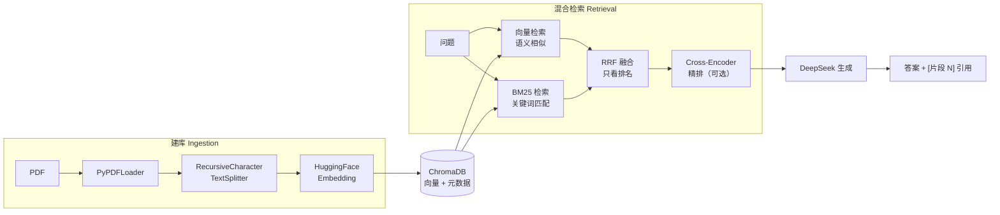

# 📚 PDF 本地知识库问答系统（RAG）

> 一个基于 **RAG（Retrieval-Augmented Generation，检索增强生成）** 的 PDF 知识库问答系统。
> 上传 PDF → 自动切分、向量化入库 → 提问 → **混合检索** → 结合 **DeepSeek** 生成有据可依的回答。
>
> 检索层实现了**向量检索 + BM25 关键词检索 + RRF 融合 + Cross-Encoder 精排**四种可切换策略，
> 并配有一套**可复现的检索质量评估**，用于量化对比不同策略的优劣。


---

## ✨ 核心特性

**检索层**

- 🔀 **混合检索**：向量检索（语义）+ BM25（关键词）双路召回，用 **RRF 融合**
- 🎯 **可切换策略**：`vector` / `bm25` / `hybrid` / `hybrid_rerank` 四种模式，一行配置切换
- 📊 **检索质量评估**：内置 `Hit@K` / `Recall@K` / `MRR` 三个指标，可横向对比不同策略
- 🧮 **Cross-Encoder 精排**（可选）：对融合后的候选做二次精排，模型不可用时自动降级

**链路层**

- 📄 上传单个或多个 **PDF** 文件，自动提取文本
- ✂️ 文本切分为文本块（chunk），保留上下文重叠
- 🧮 本地 **HuggingFace Embedding**（`BAAI/bge-small-zh-v1.5`），无需额外 API Key
- 💾 向量持久化到 **ChromaDB**，重启无需重新 Embedding
- 🤖 拼接 RAG Prompt，调用 **DeepSeek** 生成回答，并要求模型用 `[片段 N]` 标注依据
- 📑 展示答案 + 原文片段 + 来源文件名 + 页码 + 相关分
- ♻️ 基于文件哈希去重，重复 PDF 不重复处理

---

## 🧭 系统架构



---

## 🔍 为什么需要混合检索

只用向量检索会遇到一类明确的问题：**必须精确命中的查询反而容易漏。**

比如问「ChromaDB 是用来做什么的」，向量检索会把"ChromaDB"编码成一个语义向量，
于是它可能和一堆泛泛的"数据库""存储"段落混在一起；而 BM25 基于词频与逆文档频率打分，
对这类专有名词、型号、缩写极其敏感，几乎一击即中。

反过来，向量检索擅长的是**语义改写**——用户问「一本正经地胡说八道该怎么治」，
语料里写的是「知识幻觉」，两者没有共同词，BM25 直接落空，向量检索却能匹配上。

两者互补，所以都留着，融合起来用。

### 融合为什么用 RRF，而不是加权求和

这是这个模块里最关键的一个决定。两路检索的**分数不可比**：

| | 取值范围 | 含义 |
|---|---|---|
| 向量检索 | 0 ~ 1 | 余弦相似度 |
| BM25 | 无上界，依赖语料统计 | 词频 × 逆文档频率的加权和 |

如果直接 `0.7 × 向量分 + 0.3 × BM25 分`，结果会被 BM25 的数量级完全主导，
那个 0.7 / 0.3 就是假的权重。要加权就得先归一化，而归一化窗口怎么选又是新的主观决定，
换一份语料就不成立了。

**RRF（Reciprocal Rank Fusion）绕开了整个问题：它只看排名，不看分数。**

```
score(doc) = Σ  1 / (k + rank_i(doc))        k 取 60（原论文经验值）
             i
```

每路检索器各贡献"一份排名"，量纲差异自然消失，也不需要调权重。

### Rerank 放在哪，为什么是可选

召回（找到候选）和排序（把对的排前面）是两件事。RRF 只用了排名信息，
并没有逐条比较"这个问题"和"这段文本"到底多相关——那是 Cross-Encoder 的活。

它以 `(问题, 候选片段)` 成对送进模型打分，比双塔（分别编码后算余弦）精度更高，
代价是慢，所以只用在**召回之后、生成之前**对少量候选做精排。

它在两种情况下自动降级为融合排序，不阻断问答：模型未安装、离线无法下载、推理异常。

---

## 📊 检索质量评估

"加了混合检索效果应该更好"是感觉，不是结论。所以项目内置了一套评估：

```bash
# 先建库（含 20 段语料：5 段 AI 主题 + 15 段干扰段落）
python scripts/verify_rag.py --build

# 横向对比四种检索策略
python scripts/evaluate.py

# 打印逐题明细，定位是哪些问题拖低了指标
python scripts/evaluate.py --verbose
```

评估**不需要 DeepSeek API Key**——只测检索，不调生成。三个指标：

| 指标 | 回答的问题 |
|------|-----------|
| `Hit@K` | 前 K 条里**至少**命中一条相关片段的问题占比——找得到吗？ |
| `Recall@K` | 前 K 条覆盖了多少比例的全部相关片段——找得全吗？ |
| `MRR` | 第一条相关片段排名的倒数均值——排得靠前吗？ |

### 实测结果（15 题，K=5）

```
检索模式            Hit@K  Recall@K     MRR
--------------------------------------------
vector              0.933     0.900   0.800
bm25                0.867     0.867   0.833
hybrid              0.933     0.900   0.867      ← 默认策略
hybrid_rerank       0.867     0.833   0.822

按问题类型拆分（Hit@K）：
检索模式               keyword      semantic semantic-hard
vector               1.000         1.000         0.667
bm25                 1.000         1.000         0.333
hybrid               1.000         1.000         0.667
hybrid_rerank        1.000         1.000         0.333
```

**读出来的结论（包括对本项目不利的）：**

1. **混合检索在 MRR 上最优（0.867）**，同时 Hit/Recall 追平纯向量检索。
   这说明 RRF 融合确实提升了排序质量，且没有牺牲召回——符合预期。

2. **BM25 单用最弱（Hit@5 0.867）**，差距全部出在 `semantic-hard`
   （纯语义改写题，0.333）：问题与语料没有共同词时它直接落空。
   这正是它必须和向量检索搭配的原因。

3. **Rerank 反而让指标下降了**（Hit@5 从 0.933 掉到 0.867，MRR 从 0.867 掉到 0.822）。

   这是个值得如实记录的结果。可能的原因：本项目用的是通用中文重排模型
   `bge-reranker-base`，而语料是**短文本块**（约 170 字）；重排模型在
   训练分布上与这个场景不完全吻合，在语义改写题上会把字面更接近的干扰段落排到前面。

   **所以 `hybrid` 是默认策略，`hybrid_rerank` 保留为可选。** rerank 不是无条件有效的，
   它取决于模型与语料的匹配度——这一点不实测是发现不了的。

4. 三个 `keyword` / `semantic` 类别上各模式都是满分，说明**评估集偏简单**。
   真正拉开差距的是 `semantic-hard` 这一类。评估集想真正有区分度，
   需要更多这类改写题，以及你自己的真实语料。

### 评估方法的局限（必须说明）

- **相关性判定是关键词匹配**：文本块包含标注关键词即视为相关。这是一个
  粗略但可复现的定义，偏向字面命中，会低估纯语义检索的表现。
  真实项目应使用人工标注标签，或引入 LLM 作为评判员。
- **语料是合成的**：由 `scripts/generate_test_pdf.py` 生成，共 20 段
  （5 段 AI 主题 + 15 段无关干扰段落）。加干扰段落是必需的——
  否则语料条数少于 Top-K 时，任何策略都会"全中"，评估没有区分度。
- **样本量小（15 题）**：这些数字适合用来**横向对比不同策略**，
  不适合对外宣称绝对效果。

---

## 🛠️ 技术栈

| 组件 | 说明 |
|------|------|
| Python | 3.11+ |
| LangChain | 文档加载、切分、检索编排 |
| PyPDFLoader | PDF 文本提取 |
| RecursiveCharacterTextSplitter | 文本切分 |
| HuggingFace Embedding | 本地中文语义向量（`BAAI/bge-small-zh-v1.5`） |
| ChromaDB | 向量存储与检索（持久化） |
| jieba + rank-bm25 | 中文分词与 BM25 关键词检索 |
| CrossEncoder | 重排（`BAAI/bge-reranker-base`，可选） |
| DeepSeek API | 大语言模型（`deepseek-chat`） |
| Streamlit | Web 交互界面 |

---

## 📁 目录结构

```
RAG-Project/
├── app.py                      # Streamlit 页面（上传、问答、展示）
├── requirements.txt            # 依赖清单
├── README.md                   # 本文档
├── .env.example                # 环境变量模板
│
├── src/
│   ├── config.py               # 集中配置（路径、模型、检索参数）
│   ├── loader.py               # PDF 加载
│   ├── splitter.py             # 文本切分
│   ├── embeddings.py           # Embedding 模型
│   ├── vector_store.py         # ChromaDB 持久化与全量读取
│   ├── bm25.py                 # 中文分词 + BM25 关键词检索
│   ├── fusion.py               # RRF 融合
│   ├── rerank.py               # Cross-Encoder 精排（含降级）
│   ├── retriever.py            # 检索统一入口，按模式分发
│   ├── evaluate.py             # 检索质量评估与指标计算
│   ├── llm.py                  # DeepSeek 模型
│   ├── dedup.py                # PDF 去重（文件哈希）
│   └── rag_chain.py            # RAG 业务编排
│
├── eval/
│   └── qa_set.jsonl            # 评估集（问题 + 相关性关键词 + 类别）
│
├── scripts/
│   ├── generate_test_pdf.py    # 生成评估语料 PDF
│   ├── verify_rag.py           # 命令行端到端验证
│   └── evaluate.py             # 检索质量对比
│
└── tests/                      # pytest（35 个用例）
```

---

## 🚀 快速开始

### 1. 创建虚拟环境

```bash
# Windows
python -m venv .venv
.venv\Scripts\activate

# macOS / Linux
python3 -m venv .venv
source .venv/bin/activate
```

### 2. 安装依赖

```bash
pip install -r requirements.txt
```

> 首次安装会下载 `torch`、`sentence-transformers` 等较大包，耗时较长。

### 3. 配置环境变量

```bash
cp .env.example .env      # Windows 用 copy .env.example .env
```

编辑 `.env`：

```dotenv
DEEPSEEK_API_KEY=你的_API_Key
DEEPSEEK_BASE_URL=https://api.deepseek.com
DEEPSEEK_MODEL=deepseek-chat
```

> API Key 可在 https://platform.deepseek.com 申请。

### 4. 启动

```bash
streamlit run app.py
```

---

## 🖥️ 使用方式

1. 在左侧上传 PDF，点击「建立 / 更新知识库」
2. 等待入库完成（有进度提示）
3. 主区域输入问题，点击「开始问答」
4. 查看答案（带 `[片段 N]` 引用）、检索片段、来源页码与相关分

> ⚠️ 目前仅支持**文字版** PDF（可选中复制文字的 PDF）。纯扫描图片版需先 OCR。

---

## ⚙️ 检索配置

| 参数 | 默认值 | 说明 |
|------|--------|------|
| `RETRIEVAL_MODE` | `hybrid` | `vector` / `bm25` / `hybrid` / `hybrid_rerank` |
| `TOP_K` | 5 | 最终送给大模型的文本块数量 |
| `CANDIDATE_K` | 20 | 每路检索各自召回的候选数（融合前） |
| `RRF_K` | 60 | RRF 平滑常数（原论文经验值） |
| `RERANK_ENABLED` | true | 仅 `hybrid_rerank` 模式生效；设为 false 可对比精排增益 |
| `RERANK_MODEL` | `BAAI/bge-reranker-base` | 重排模型（首次使用需下载） |
| `CHUNK_SIZE` | 1000 | 每个文本块的最大字符数 |
| `CHUNK_OVERLAP` | 200 | 相邻文本块的重叠字符数 |

**为什么 `CANDIDATE_K` 必须大于 `TOP_K`：** 融合与重排只能对**已有候选**重新排序，
无法把没召回的东西变出来。只召回 5 条再融合，两路检索各自的第一名只能原样保留，
融合就没有腾挪空间。先多召回、再精排，是这类流水线的通用做法。

> 注意：不同模式的相关分**量纲不同**（向量相似度 / BM25 原始分 / RRF 融合分），
> 只能在同一种模式内部比较高低，不要跨模式比较数值。

---

## 🧪 测试

```bash
pytest -q      # 35 passed
```

`bm25` / `fusion` / `evaluate` / `rerank` 四个模块的测试**不依赖 ChromaDB 与
Embedding 模型**（不需要下载模型、不需要 API Key），因为 BM25 打分、RRF 融合、
指标计算都是纯逻辑，重排模块也只在真正调用时才加载模型。

---

## 🚧 当前限制

1. **PDF 换行会切断英文单词。** PyPDFLoader 提取的文本按排版换行，
   `Transformer` 可能变成 `Transfo\nrmer`。这会让 BM25 的分词把它切成两段、
   无法命中该专有名词。评估模块已通过空白归一化规避（否则相关性判定会出错），
   但检索侧尚未修复——不能简单地把"字母+换行+字母"都接起来，
   那样会把真正的词边界（`Vector\nDatabase`）也粘错。需要更细的判据。
2. 仅支持文字版 PDF，不支持扫描版（需 OCR）
3. 本地 CPU 运行 Embedding 与 Rerank，大批量入库速度有限
4. 暂不支持多轮对话（每次问答独立）
5. 关键词检索的索引建在内存中，语料量级到十万以上需换成倒排索引

## 🗺️ 路线图

- [ ] 修复 PDF 断词问题（更稳妥的换行修复策略，或换用版面感知的 PDF 解析）
- [ ] 引入 rerank 模型的本地微调或更换更适合短文本的重排模型
- [ ] 扩充评估集，引入人工标注与 LLM-as-judge
- [ ] 支持多轮对话，结合历史上下文
- [ ] 接入 OCR，支持扫描版 PDF
- [ ] 增加知识库管理（删除、更新单个文档）
- [ ] 支持更多文件格式（Word、Markdown、网页等）
